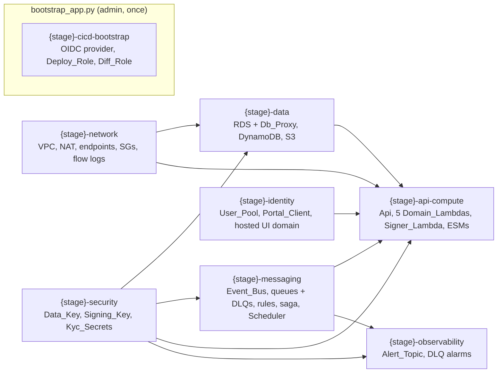

# Design Document: real-estate-tokenization-iac

## Overview

This design covers spec 1 of the "Tokenización Inmobiliaria" MVP infrastructure: an AWS CDK v2 application in Python that deploys the core backend, and the Cognito and API settings for one single-page application (the Portal_App), into a single AWS account. The Portal_App is an Amplify Hosting app created by hand (D4); this repository creates no Amplify resources. The repository contains infrastructure only. The .NET Lambda zip packages come from a separate application repository and are referenced through Artifact_References in Stage_Config.

The design rests on four choices:

1. **One validated Stage_Config per stage.** Each stage is a YAML file in `config/stages/`, parsed by a pydantic v2 model at synthesis time. To add a stage, add a file. Stack code does not change.
2. **Pure logic separated from CDK wiring.** Config parsing, naming, URL derivation, permission profiles, saga substitution, parameter names and OIDC subjects live in `tokenization_infra.core`, which does not import `aws_cdk`. Hypothesis property tests cover this package. The stacks are covered by `aws_cdk.assertions` example tests and cdk-nag.
3. **A one-way stack graph.** When a cross-stack reference would create a cycle, the design builds ARNs from deterministic, stage-prefixed names instead (decision D1).
4. **No custom resources.** Every resource is an L2 or L1 construct from `aws-cdk-lib`. Construct options that add custom resources are turned off. A test scans every template (Requirement 1.12). The allowlist is empty.

### Verified platform facts

These facts were checked against current documentation. Sources are listed at the end.

| Topic | Finding | Decision |
|---|---|---|
| RDS Proxy IAM auth | Clients authenticate to the proxy with IAM (`rds-db:connect` on `arn:aws:rds-db:<region>:<account>:dbuser:prx-<id>/<user>`). The proxy reaches the database with Secrets Manager credentials. | L2 `rds.DatabaseProxy` with `iam_auth=True` and `require_tls=True`. Each database-using role gets `proxy.grant_connect(role, app_user)`. End-to-end IAM to the database is not used. |
| EventBridge Scheduler | `aws_cdk.aws_scheduler` (`ScheduleGroup`, `Schedule`) is stable. | Use the L2 `ScheduleGroup` and an explicit `iam.Role` as the execution role. |
| Stellar signing key | KMS supports `ECC_NIST_EDWARDS25519` (Ed25519, sign/verify only). The CDK Python enum `kms.KeySpec.ECC_NIST_EDWARDS25519` exists. | Use `kms.Key(key_spec=KeySpec.ECC_NIST_EDWARDS25519, key_usage=KeyUsage.SIGN_VERIFY)`. No escape hatch is needed. |
| GitHub OIDC provider | `aws_cdk.aws_iam.OidcProviderNative` exists in Python and synthesizes `AWS::IAM::OIDCProvider`. The older `OpenIdConnectProvider` is backed by a custom resource. | Use `OidcProviderNative`. |
| cdk-nag | The latest Python release is `cdk-nag` 3.0.2 (requires Python 3.10 or later). v3 registers through `aws_cdk.Validations.of(app).add_plugins(AwsSolutionsChecks(app))` and suppresses findings with `Validations.of(construct).acknowledge(...)`. `NagSuppressions` was removed. If any plugin reports a violation, synthesis is interrupted. Findings with sub-ids (for example `AwsSolutions-IAM5[Resource::*]`) are acknowledged one by one. | Use cdk-nag v3. Keep all acknowledgements in `tokenization_infra/nag/acknowledgements.py`. Fallback: open item O4. |
| Cognito PKCE | Cognito supports PKCE in the authorization code grant for public clients. No app client setting makes PKCE mandatory. | The Portal_Client allows only the code grant and has no secret. The SPA library sends PKCE. See open item O6. |

### Toolchain

| Tool | Version or rule |
|---|---|
| Python | 3.12 or later (`.python-version` = `3.12`, `requires-python = ">=3.12"`) |
| uv | dependency and virtualenv manager. `pyproject.toml` declares dependencies and `uv.lock` pins them. CI runs `uv sync --frozen`. |
| `aws-cdk-lib` | `==2.277.0` (exact pin; cdk-nag 3 needs at least 2.257.0) |
| `constructs` | `>=10,<11` |
| `cdk-nag` | `==3.0.2` |
| `pydantic` | `>=2,<3` (the stage model; error locations give field paths) |
| `PyYAML` | stage files (`yaml.safe_load` only) |
| Dev: `pytest`, `hypothesis`, `ruff`, `mypy`, `types-PyYAML` | latest at implementation time, locked by uv |
| CDK CLI | `aws-cdk` `2.1148.1`, pinned in a minimal `package.json` and `package-lock.json` that contain only the CLI |
| Node.js | 24 LTS, added to `devbox.json` (`nodejs@24`) and installed in CI. It is needed only for the CDK CLI. |

`cdk.json` sets `"app": "uv run --frozen python app.py"` and the context default `"stage": "dev"`.

### Key design decisions

- **D1: Deterministic names where a reference would create a cycle.** The Saga_State_Machine (messaging stack) needs Domain_Lambda ARNs, and the Domain_Lambdas (api-compute stack) need queue URLs and the state machine ARN. The state machine definition and its role policy use ARNs built from function names (`arn:{partition}:lambda:{region}:{account}:function:{stage}-{fn}`). Step Functions does not check that the function exists when it creates the machine. The Scheduler role policy, the Signing_Key policy (signer role ARN) and the Kyc_Secrets resource policies (Stellar_KYC role ARN) use the same technique.
- **D2: Consumers import KMS keys by ARN.** Stacks other than `security` call `kms.Key.from_key_arn`. CDK then writes grants into the consumer role's identity policy and never edits the key policy in another stack, which would create a back-reference. The Data_Key policy declares the service principals that cannot use caller grants up front, each with `aws:SourceAccount`: `events.amazonaws.com` (rule targets and rule DLQs are encrypted SQS queues) and `cloudwatch.amazonaws.com` (alarm actions publish to the encrypted Alert_Topic).
- **D3: The Api requires access tokens.** API Gateway checks `authorization_scopes` only on access tokens, so the Portal_App must send the Cognito access token, not the ID token. Requirement 5.3 needs scopes, so this follows from the requirements. It is recorded so the front-end team knows.
- **D4: The Portal_App is created by hand (decided).** Amplify Hosting apps are created and configured outside the IaC_App (assumption A8, Requirement 4.11): app, branch, SPA rewrite rule, repository connection, custom domain and environment variables. Stage_Config holds the resulting HTTPS origin in `portal.origin` (4.9, 4.10). Cognito callback and logout URLs and the Api CORS settings are derived from it. Because nothing in the IaC depends on an Amplify resource, there is no API/Amplify cycle and no portal branch stack. The `identity` stack publishes the Portal_Client ID and the hosted UI domain as Extension_Parameters (11.4), so operators copy them, the User_Pool ID and the Api base URL into the Portal_App environment variables. Order of operations: create the Amplify app and branch, record the origin in Stage_Config, deploy, then set the environment variables and redeploy the front end. If the origin changes (for example a custom domain is added), update `portal.origin` and redeploy, or sign-in redirects and CORS fail.
- **D5: A dedicated database user.** Lambdas connect as `app_user`, not as the master user. The IaC generates the `app_user` secret and registers it with the Db_Proxy. The application repository's migrations create the PostgreSQL role. This is a documented post-deploy step.
- **D6: Deny statements back up the exclusive grants.** Identity policies give `kms:Sign` only to the signer role, and `secretsmanager:GetSecretValue` on Kyc_Secrets only to the Stellar_KYC role. In addition, the Signing_Key policy denies `kms:Sign` to every principal whose `aws:PrincipalArn` is not the signer role, and each Kyc_Secret resource policy denies `GetSecretValue` to every principal except the Stellar_KYC role.
- **D7: The Bootstrap_Stack has its own entry point.** `bootstrap_app.py` synthesizes only the Bootstrap_Stack. `app.py` never contains it, so `cdk deploy --all` in the Pipeline cannot deploy it (Requirement 13.3). An admin deploys it once with `npx cdk --app "uv run --frozen python bootstrap_app.py" deploy`. Requirement 1.11 states that the Bootstrap_Stack lives in a separate CDK app (decided).
- **D8: Availability Zones are listed in Stage_Config.** With explicit AZs, `ec2.Vpc` does not need an `availability-zones` context lookup. Synthesis then works in pull-request CI before any AWS credentials exist, and in unit tests. Requirements 1.2 and 2.1 name the Availability Zones in Stage_Config (decided).
- **D9: Log groups use the default CloudWatch Logs encryption.** The requirements ask for retention, not customer managed keys, on log groups. Leaving out the `logs` service principal keeps the Data_Key policy small (decided, see O5).
- **D10: The API Gateway execution log group is pre-created.** With `logging_level=ERROR`, API Gateway writes execution logs to `API-Gateway-Execution-Logs_{restApiId}/{stage}` and creates that group without retention if it does not exist. The api-compute stack creates `logs.LogGroup(log_group_name=f"API-Gateway-Execution-Logs_{api.rest_api_id}/{stage}", retention=...)` and adds it as a dependency of `api.deployment_stage`, so the group exists with retention before the stage can log (Requirement 10.1). This is a plain `AWS::Logs::LogGroup`, not a custom resource. A recreated Api gets a new `restApiId`, so a retained group from an earlier deployment never collides with the name.
- **D11: The Hosted UI domain prefix is used as configured.** `cognito.domain_prefix` already carries the stage (for example `dev-tokenization-portal`). Config validation requires it to start with `{stage}-` (Requirement 1.9), and the stack passes it unchanged, so the stage is never prefixed twice.

## Architecture

### Stack graph



Arrows point from producer to consumer. `network` and `identity` have no dependencies. `messaging` does not depend on `api-compute` (D1). Each stack publishes the Extension_Parameters for the resources it owns, so a later spec reads them without touching spec 1 stacks.

### Request flow

```mermaid
sequenceDiagram
  participant U as Browser (Portal_App, Amplify app created by hand)
  participant C as Cognito hosted UI
  participant G as Api (REST, regional)
  participant L as Stellar_KYC Lambda
  participant S as Signer_Lambda
  participant K as KMS Signing_Key
  participant X as Stellar / Anchor / KYC (internet)
  U->>C: authorization code + PKCE
  C->>U: redirect to callback, then token exchange
  U->>G: HTTPS + access token
  G->>G: Cognito_Authorizer checks token and scopes
  G->>L: Lambda proxy integration
  L->>S: lambda:Invoke
  S->>K: kms:Sign (Ed25519)
  L->>X: HTTPS 443 through NAT
  X-->>G: POST /webhooks/kyc/{provider} (no Cognito; Lambda checks the webhook signature)
```

### Repository layout

```
app.py                      # entry: resolve stage, build stacks, tags, cdk-nag
bootstrap_app.py            # entry for the Bootstrap_Stack only (D7)
cdk.json                    # app command, context stage=dev, feature flags
pyproject.toml, uv.lock, .python-version
package.json, package-lock.json   # aws-cdk CLI pin only
config/
  stages/dev.yaml
  statemachines/tokenization-saga.asl.json
src/tokenization_infra/
  app_builder.py            # build_app(app, cfg) -> StackSet
  core/                     # pure Python, no aws_cdk import
    config.py               # pydantic models, parse_stage_config, load_stage, resolve_stage
    errors.py               # ConfigError, UnknownStageError, format_loc
    naming.py               # resource_name, function_name, role_name
    urls.py                 # origin_of, is_https_origin, callback_urls, logout_urls, cors_origins
    permissions.py          # Capability, permission_profile
    saga.py                 # referenced_functions, substitute
    parameters.py           # extension_parameter_names
    oidc.py                 # oidc_subjects
    custom_resources.py     # ALLOWLIST, find_custom_resources(template)
  constructs/               # reusable CDK constructs (absolute imports only)
    domain_function.py      # role + LogGroup + lambda.Function
    queue_with_dlq.py
    secure_bucket.py
  stacks/                   # one module per stack in the graph
  nag/acknowledgements.py   # every cdk-nag acknowledgement with its reason
tests/
  core/                     # hypothesis property tests
  stacks/                   # aws_cdk.assertions tests
  test_project.py           # cdk.json feature flag, core imports no aws_cdk
  test_app.py               # stack ids, regions, tags, name rule (1.9)
  test_extension_parameters.py
  test_config_failures.py   # unknown stage, missing field, nat_gateways 0, app.py exit code
  test_nag.py
  test_custom_resources.py
  test_readme.py            # README lists Extension_Parameters and Artifact_References
  conftest.py               # session-scoped synthesized variants, hypothesis profile
.github/workflows/pr.yml, deploy.yml
README.md
```

The `core` package has no `aws_cdk` imports, and a test checks this by parsing its import statements. Ruff rule `TID252` bans relative imports, so `tokenization_infra.constructs` never shadows the `constructs` library.

## Components and Interfaces

### Entry point and app builder

```python
# app.py
import sys
import aws_cdk as cdk
from tokenization_infra.app_builder import build_app
from tokenization_infra.core.config import CONFIG_DIR, load_stage
from tokenization_infra.core.errors import ConfigError

app = cdk.App()
stage = str(app.node.try_get_context("stage") or "")
try:
    cfg = load_stage(stage, CONFIG_DIR)
except ConfigError as err:          # UnknownStageError is a subclass
    sys.exit(str(err))              # non-zero exit, message on stderr
build_app(app, cfg)
app.synth()
```

```python
# src/tokenization_infra/app_builder.py
def build_app(app: cdk.App, cfg: StageConfig) -> StackSet:
    env = cdk.Environment(account=cfg.account, region=cfg.region)
    security = SecurityStack(app, f"{cfg.stage}-security", cfg=cfg, env=env)
    network = NetworkStack(app, f"{cfg.stage}-network", cfg=cfg, env=env)
    data = DataStack(app, f"{cfg.stage}-data", cfg=cfg, network=network, security=security, env=env)
    messaging = MessagingStack(app, f"{cfg.stage}-messaging", cfg=cfg, security=security, env=env)
    identity = IdentityStack(app, f"{cfg.stage}-identity", cfg=cfg, env=env)
    api = ApiComputeStack(app, f"{cfg.stage}-api-compute", cfg=cfg, network=network,
                          security=security, data=data, messaging=messaging, identity=identity, env=env)
    observability = ObservabilityStack(app, f"{cfg.stage}-observability", cfg=cfg,
                                       security=security, messaging=messaging, env=env)
    for key, value in {"project": cfg.project, "stage": cfg.stage, "managed-by": "cdk"}.items():
        cdk.Tags.of(app).add(key, value)
    cdk.Validations.of(app).add_plugins(AwsSolutionsChecks(app))
    apply_acknowledgements(...)     # from nag/acknowledgements.py
    return StackSet(...)
```

Stacks receive typed handles from their producers (for example `network.vpc`, `security.data_key_arn`). CDK turns these into exports and imports. Every stack sets `termination_protection` when `removal_policy == "RETAIN"`.

### Core library interfaces

```python
# core/config.py
CONFIG_DIR: Path                                   # <repo>/config/stages
def parse_stage_config(raw: Mapping[str, object], *, stage: str) -> StageConfig: ...  # raises ConfigError
def resolve_stage(name: str, registry: Mapping[str, Mapping[str, object]]) -> StageConfig: ...  # raises UnknownStageError
def load_stage(name: str, config_dir: Path) -> StageConfig: ...  # reads <name>.yaml, then resolve_stage

# core/errors.py
class ConfigError(Exception): ...                   # message: "<stage>: <dotted.path>: <reason>" per issue
class UnknownStageError(ConfigError): ...           # 'Unknown stage "<x>". Known stages: dev'
def format_loc(loc: tuple[str | int, ...]) -> str: ...  # ("queues", 2, "name") -> "queues[2].name"

# core/naming.py
class NameKind(StrEnum): GENERIC, BUCKET, FUNCTION, ROLE, QUEUE, LOG_GROUP
def resource_name(stage: str, base: str, kind: NameKind, *, project: str = "", account: str = "", region: str = "") -> str: ...
def function_name(stage: str, fn: FunctionId) -> str: ...   # "{stage}-{fn}"
def role_name(stage: str, fn: FunctionId) -> str: ...       # "{stage}-{fn}-role"

# core/urls.py
def is_https_origin(url: str) -> bool: ...                # https://host[:port] with no path, query or fragment
def origin_of(url: str) -> str: ...                         # scheme://host[:port]
def callback_urls(origin: str, path: str, local_dev_urls: Sequence[str]) -> list[str]: ...
def logout_urls(origin: str, path: str, local_dev_urls: Sequence[str]) -> list[str]: ...
def cors_origins(origin: str, local_dev_urls: Sequence[str]) -> list[str]: ...

# core/permissions.py
def permission_profile(cfg: StageConfig, fn: FunctionId) -> frozenset[Capability]: ...

# core/saga.py
def referenced_functions(asl_text: str) -> frozenset[DomainFunctionId]: ...
def substitute(asl_text: str, arns: Mapping[DomainFunctionId, str]) -> str: ...

# core/parameters.py
def extension_parameter_names(project: str, stage: str) -> Mapping[ExtensionKey, str]: ...

# core/oidc.py
def oidc_subjects(owner: str, repo: str, stage: str, branch: str) -> OidcSubjects: ...  # .deploy, .pull_request

# core/custom_resources.py
ALLOWLIST: tuple[AllowlistEntry, ...] = ()  # entries: (stack, logical-id prefix, reason >= 20 chars)
def find_custom_resources(template: Mapping[str, object]) -> list[str]: ...  # logical ids of CustomResource / Custom::*
```

The URL functions accept CDK token strings as well as plain strings. CDK tokens survive string concatenation, so the stacks call the same functions that the property tests exercise with plain strings.

### Permission profiles

`permission_profile` returns a set of capabilities. Each stack turns them into IAM statements in one place (`DomainFunction.apply_profile`). Exclusivity can then be tested on pure data (Property 5), and the template scan tests confirm the result.

| Capability | collateral-identity | sagas-payments | reports | stellar-kyc | trading-operations | signer |
|---|---|---|---|---|---|---|
| `bus.put` (9.10) | yes | yes | yes | yes | yes | never |
| `saga.start` (9.4) | | yes | | | | never |
| `signer.invoke` (6.7) | | | | yes | | never |
| `signing_key.get_public_key` (3.4) | | | | yes | | yes |
| `signing_key.sign` (3.3) | | | | | | yes |
| `kyc_secrets.read` (3.6) | | | | yes | | never |
| `db.connect` (7.5) | if `uses_database` | same | same | same | same | never |
| `data:<resource>` (6.6) | per `data_access` | same | same | same | same | never |
| `queue.consume:<q>` (9.8) | if a queue names it as consumer | same | same | same | same | never |

Every function also gets the `AWSLambdaVPCAccessExecutionRole` managed policy (ENI management and log writes; acknowledged as cdk-nag IAM4), X-Ray write (added by `tracing=ACTIVE`), and `kms:Decrypt`/`kms:GenerateDataKey` on the Data_Key through `kms:ViaService` when one of its capabilities touches an encrypted resource.

### SecurityStack (`{stage}-security`)

- **Data_Key**: `kms.Key(enable_key_rotation=True, alias=f"alias/{stage}-data", removal_policy=RETAIN)`. The key policy has the default account-root statement (which delegates to IAM) plus the two service statements from D2.
- **Signing_Key**: `kms.Key(key_spec=ECC_NIST_EDWARDS25519, key_usage=SIGN_VERIFY, alias=f"alias/{stage}-stellar-signing", removal_policy=RETAIN)`. Asymmetric keys do not rotate. The key policy adds the Deny from D6.
- **Kyc_Secrets**: for each `kyc_providers[i]`, two `secretsmanager.Secret` resources, `{stage}/kyc/{provider}/api-credentials` and `{stage}/kyc/{provider}/webhook-signing`, with `encryption_key=data_key`. The value is the non-secret placeholder `{}` (`SecretValue.unsafe_plain_text("{}")`), so no random value is generated. Operators set the real values after deployment. The resource policy holds the Deny from D6. The removal policy comes from Stage_Config.
- Extension_Parameters: `keys/data-key-arn`, `keys/signing-key-arn`.

### NetworkStack (`{stage}-network`)

- `ec2.Vpc` with:
  - `ip_addresses=IpAddresses.cidr(cfg.network.cidr)`, `availability_zones=cfg.network.availability_zones` (exactly 2, D8), `nat_gateways=cfg.network.nat_gateways`
  - subnet groups `public` (PUBLIC, /24), `private` (PRIVATE_WITH_EGRESS, /22), `isolated` (PRIVATE_ISOLATED, /24)
  - `restrict_default_security_group=False`. The feature flag `@aws-cdk/aws-ec2:restrictDefaultSecurityGroup` is also `false` in `cdk.json` (Requirement 1.13). Turning it on would add a custom resource.
- Gateway endpoints for S3 and DynamoDB on the private and isolated route tables.
- Interface endpoints with private DNS in the private subnets: `SECRETS_MANAGER`, `KMS`, `SQS`, `STEP_FUNCTIONS`, `EVENTBRIDGE`, `CLOUDWATCH_LOGS`, `XRAY`, `STS`. They use `endpoint_sg`, which allows ingress TCP 443 from the VPC CIDR only.
- Security groups, all with `allow_all_outbound=False`:
  - `lambda_sg`: egress TCP 443 to `0.0.0.0/0`, egress TCP 5432 to `proxy_sg`
  - `proxy_sg`: ingress TCP 5432 from `lambda_sg` only. Egress TCP 5432 to `db_sg`, and TCP 443 to the VPC CIDR so the proxy can reach the Secrets Manager endpoint.
  - `db_sg`: ingress TCP 5432 from `proxy_sg` only, no egress
- Flow log: `vpc.add_flow_log` with `traffic_type=ALL` to an explicit `logs.LogGroup` `/{stage}/vpc/flow-logs` that has the configured retention.
- Extension_Parameters: `network/vpc-id`, `network/private-subnet-ids` and `network/isolated-subnet-ids` (comma-separated `String` values), `network/lambda-security-group-id`.

Calls between Lambdas (Stellar_KYC to Signer) and to Cognito leave through the NAT gateway, because Requirement 2.6 does not list Lambda or Cognito endpoints.

### DataStack (`{stage}-data`)

- **Database**: `rds.DatabaseInstance`
  - `engine=DatabaseInstanceEngine.postgres(version=PostgresEngineVersion.of(v, v.split(".")[0]))`, `instance_type` from `database.instance_class`
  - `allocated_storage`, `multi_az` and `backup_retention` from config
  - `instance_identifier=f"{stage}-db"`, `vpc_subnets=isolated`, `security_groups=[db_sg]`
  - `storage_encrypted=True`, `storage_encryption_key=data_key` (imported)
  - `credentials=Credentials.from_generated_secret("postgres_admin", encryption_key=data_key, secret_name=f"{stage}/db/master")`
  - `iam_authentication=True` (satisfies cdk-nag RDS6; proxy clients use IAM either way)
  - parameter group with `rds.force_ssl=1`
  - `cloudwatch_logs_exports=["postgresql"]` into a pre-created `LogGroup` named `/aws/rds/instance/{stage}-db/postgresql` with retention. `cloudwatch_logs_retention` is not set, because it adds a custom resource.
  - `deletion_protection = (removal_policy == "RETAIN")`, and `removal_policy` mapped from config (`RETAIN` or `DESTROY`; `SNAPSHOT` is not offered)
- **App user secret**: `rds.DatabaseSecret(username=cfg.database.app_user, encryption_key=data_key, secret_name=f"{stage}/db/{app_user}")` (D5).
- **Db_Proxy**: `rds.DatabaseProxy(proxy_target=ProxyTarget.from_instance(db), secrets=[master_secret, app_secret], vpc_subnets=private, security_groups=[proxy_sg], iam_auth=True, require_tls=True, db_proxy_name=f"{stage}-db-proxy")`.
- **Tables** (`dynamodb.TableV2`, `billing=Billing.on_demand()`, `encryption=TableEncryptionV2.customer_managed_key(data_key)`, PITR on):
  - `{stage}-idempotency`: partition key `pk` (string), `time_to_live_attribute="expiresAt"`
  - `{stage}-saga`: `pk` and `sk` (strings), `dynamo_stream=StreamViewType.NEW_AND_OLD_IMAGES`
- **Buckets** through the `SecureBucket` construct, which always sets `block_public_access=BLOCK_ALL`, `enforce_ssl=True` and `object_ownership=BUCKET_OWNER_ENFORCED`, and never sets `auto_delete_objects`:
  - Access_Log_Bucket `{stage}-{project}-access-logs-{account}-{region}`: SSE-S3 (server access log targets cannot use SSE-KMS), lifecycle expiry `observability.access_log_expiration_days`. cdk-nag S1 is acknowledged because this bucket is the log sink.
  - Documents_Bucket `{stage}-{project}-documents-{account}-{region}`: `versioned=True`, SSE-KMS with the Data_Key, `bucket_key_enabled=True`, `server_access_logs_bucket=access_logs`, `server_access_logs_prefix="documents/"`.
- Outputs: tables, buckets, `proxy`, `app_user`.

### MessagingStack (`{stage}-messaging`)

- **Event_Bus**: `events.EventBus(event_bus_name=f"{stage}-tokenization")` with `bus.archive("Archive", archive_name=f"{stage}-tokenization-archive", retention=Duration.days(events.archive_retention_days), event_pattern=EventPattern(account=[account]))`.
- **Work_Queues**: for each `queues[i]`, `QueueWithDlq` creates the DLQ `{stage}-{name}-dlq` (14-day retention) and the queue `{stage}-{name}` with `dead_letter_queue=DeadLetterQueue(queue=dlq, max_receive_count=...)` and `visibility_timeout` from config. Both use `encryption=QueueEncryption.KMS`, `encryption_master_key=data_key` and `enforce_ssl=True`.
- **Saga_State_Machine**: `sfn.StateMachine(state_machine_name=f"{stage}-tokenization-saga", state_machine_type=STANDARD, tracing_enabled=True)`.
  - `definition_body=DefinitionBody.from_string(substitute(text, arns))`. `text` is the file at `saga.definition_file`, and `arns` maps each function from `referenced_functions(text)` to its deterministic ARN (D1).
  - `logs=LogOptions(destination=LogGroup(f"/{stage}/states/tokenization-saga", retention), level=LogLevel.ALL, include_execution_data=True)`
  - The role policy has `lambda:InvokeFunction` on `arn` and `arn:*` for each referenced function only.
- **Rules**: for each `rules[i]`, `events.Rule(rule_name=f"{stage}-{name}", event_bus=bus, event_pattern=...)`. The target is `targets.SqsQueue(queue, dead_letter_queue=rule_dlq)` or `targets.SfnStateMachine(saga, dead_letter_queue=rule_dlq)`. Each rule gets its own encrypted DLQ, `{stage}-{name}-target-dlq`.
- **Scheduler**: `scheduler.ScheduleGroup(schedule_group_name=f"{stage}-schedules")` and `iam.Role(role_name=f"{stage}-scheduler-role")`, trusted by `scheduler.amazonaws.com` with `aws:SourceAccount`. Permissions cover only `scheduler.targets` entries: `lambda:InvokeFunction` on deterministic ARNs, `states:StartExecution` on the saga, `sqs:SendMessage` on named queues, and Data_Key use when an SQS target exists.
- Extension_Parameters: `events/bus-name`, `events/bus-arn`.
- Outputs: `bus`, `queues: dict[str, QueueWithDlq]`, `all_dlqs` (work-queue DLQs and rule-target DLQs), `saga`.

### IdentityStack (`{stage}-identity`)

- **User_Pool**: `cognito.UserPool(user_pool_name=f"{stage}-users")`
  - `sign_in_aliases=SignInAliases(email=True)`, `self_sign_up_enabled=True`, `auto_verify=AutoVerifiedAttrs(email=True)`
  - `password_policy=PasswordPolicy(min_length=12, require_lowercase=True, require_uppercase=True, require_digits=True, require_symbols=True)`
  - `mfa=Mfa.OPTIONAL`, `mfa_second_factor=MfaSecondFactor(otp=True, sms=False)`, `account_recovery=EMAIL_ONLY`
  - `deletion_protection` and the removal policy follow Stage_Config
- **Groups**: one `cognito.CfnUserPoolGroup` per `cognito.groups[i]` (default `investor`, `seller`, `backoffice`).
- **Resource_Server**: `user_pool.add_resource_server(identifier=cognito.resource_server.identifier, scopes=[ResourceServerScope(...)...])`.
- **Hosted UI domain**: `user_pool.add_domain(cognito_domain=CognitoDomainOptions(domain_prefix=cfg.cognito.domain_prefix))`. The prefix is used as given; config validation has already checked that it starts with `{stage}-` (D11). The full domain is `{prefix}.auth.{region}.amazoncognito.com`.
- **Portal_Origin**: `cfg.portal.origin`, validated at parse time (D4). No Amplify construct is created (4.11).
- **Portal_Client**: `user_pool.add_client("PortalClient", ...)`
  - `generate_secret=False`, `o_auth=OAuthSettings(flows=OAuthFlows(authorization_code_grant=True), scopes=[OPENID, EMAIL, PROFILE, *resource server scopes from portal.scopes], callback_urls=callback_urls(...), logout_urls=logout_urls(...))`
  - `auth_flows` with every flow off, so the only explicit flow is `ALLOW_REFRESH_TOKEN_AUTH`. A test asserts the synthesized `ExplicitAuthFlows`. If the L2 cannot produce exactly that list, a property override sets it and cdk-nag gets an acknowledgement.
  - `prevent_user_existence_errors=True`
- Extension_Parameters: `identity/user-pool-id`, `identity/user-pool-arn`, `identity/resource-server-identifier`, `identity/portal-client-id`, `identity/hosted-ui-domain`.
- Outputs: `user_pool`, `resource_server`, `portal_client`, `portal_origin`, `cors_origins`.

### ApiComputeStack (`{stage}-api-compute`)

- **DomainFunction construct**, one per function id (five Domain_Lambdas and the Signer):
  - `iam.Role(role_name=role_name(stage, fn))` trusted by `lambda.amazonaws.com`
  - `logs.LogGroup(log_group_name=f"/aws/lambda/{function_name}", retention=...)`. The `log_retention` option is not used, because it adds a custom resource.
  - `lambda.Function`:
    - `function_name`, `runtime` (`dotnet8` maps to `Runtime.DOTNET_8`; `dotnet10` maps to `Runtime("dotnet10", RuntimeFamily.DOTNET_CORE)`), `architecture`, `handler`
    - `code=Code.from_bucket_v2(Bucket.from_bucket_name(...), key, object_version=version)`
    - `memory_size`, `timeout` and `reserved_concurrent_executions` from config (`None` means unreserved)
    - `vpc`, `vpc_subnets=private`, `security_groups=[lambda_sg]`, `tracing=Tracing.ACTIVE`, `log_group=log_group`
  - `apply_profile(permission_profile(cfg, fn))` writes the IAM statements.
- **Environment variables**:
  - Each function gets the identifiers of the resources it uses (Requirement 6.8), derived from its permission profile:
  - Every Domain_Lambda: `STAGE`, `EVENT_BUS_NAME`, `ALLOWED_ORIGINS` (comma-separated, for CORS headers in proxy responses)
  - `IDEMPOTENCY_TABLE`, `SAGA_TABLE`, `DOCUMENTS_BUCKET`: only for the entries in the function's `data_access`
  - `DB_PROXY_ENDPOINT`, `DB_PORT=5432`, `DB_NAME`, `DB_USER`: only when `uses_database` is true
  - `SAGA_STATE_MACHINE_ARN`: only for sagas-payments
  - `QUEUE_URLS` (a JSON object mapping queue name to URL): only for the queues the function consumes
  - Stellar_KYC also gets `KYC_SECRET_ARNS` (JSON) and `SIGNER_FUNCTION_NAME`
  - Signer gets only `STAGE` and `SIGNING_KEY_ID`
- **Event source mappings**: `consumer.add_event_source(SqsEventSource(queue, batch_size=..., report_batch_item_failures=True))` for each queue.
- **Api**: `apigateway.RestApi(rest_api_name=f"{stage}-tokenization-api")` with:
  - `endpoint_configuration=EndpointConfiguration(types=[REGIONAL])`
  - `cloud_watch_role=True` and `cloud_watch_role_removal_policy=RETAIN`. Access logging needs the account-level API Gateway CloudWatch role. This synthesizes `AWS::ApiGateway::Account`, not a custom resource. See open item O9.
  - `deploy_options=StageOptions(stage_name=stage, access_log_destination=LogGroupLogDestination(LogGroup(f"/{stage}/apigateway/access", retention)), access_log_format=AccessLogFormat.json_with_standard_fields(...), tracing_enabled=True, logging_level=ERROR, metrics_enabled=True, throttling_rate_limit=..., throttling_burst_limit=...)`
  - `default_cors_preflight_options=CorsOptions(allow_origins=identity.cors_origins, allow_methods=[GET, POST, PUT, PATCH, DELETE, OPTIONS], allow_headers=["Authorization", "Content-Type", "Idempotency-Key", "X-Amz-Date"])`. With more than one origin, CDK generates an `OPTIONS` mock integration that echoes the request origin only when it is in the list.
  - A `RequestValidator` for body and parameters.
- **Execution log group** (D10): `logs.LogGroup(log_group_name=f"API-Gateway-Execution-Logs_{api.rest_api_id}/{stage}", retention=...)`, with `api.deployment_stage.node.add_dependency(exec_log_group)`.
- **Gateway responses**: `DEFAULT_4XX` and `DEFAULT_5XX` with `Access-Control-Allow-Origin` set to the Portal_Origin and `Vary: Origin`. A gateway response header holds one static value, so local development origins are not listed there. Requirement 5.10 allows only the Portal_Origin (decided, see O7).
- **Cognito_Authorizer**: `CognitoUserPoolsAuthorizer(cognito_user_pools=[user_pool], authorizer_name=f"{stage}-cognito")`.
- **Routes**: for each Domain_Lambda, the base path `/{fn}` and `/{fn}/{proxy+}` with `ANY`, `LambdaIntegration(fn, proxy=True)`, `authorization_type=COGNITO` and `authorization_scopes=api.route_scopes[fn]`. The Signer has no route.
- **KYC_Webhook_Routes**: `/webhooks/kyc/{provider}` `POST` to Stellar_KYC with `authorization_type=NONE`, the `provider` path parameter required, and the body validator. The Lambda verifies the provider's webhook signature with the webhook-signing secret (application code). cdk-nag APIG4 and COG4 are acknowledged on this method only.
- Extension_Parameters: `api/id`, `api/root-resource-id`, `api/base-url`.

### ObservabilityStack (`{stage}-observability`)

- **Alert_Topic**: `sns.Topic(topic_name=f"{stage}-alarms", master_key=data_key, enforce_ssl=True)` and one `EmailSubscription` per `observability.alarm_emails[i]`.
- **DLQ alarms**: for each queue in `messaging.all_dlqs`, a `cloudwatch.Alarm` on `ApproximateNumberOfMessagesVisible` (statistic Maximum, period 1 minute, 1 evaluation period, `GreaterThanThreshold` 0, missing data `NOT_BREACHING`), with `add_alarm_action(SnsAction(topic))` and `add_ok_action(SnsAction(topic))`. The threshold is fixed by Requirement 10.4 and is not configurable.
- Extension_Parameters: `observability/alert-topic-arn`.

### Extension_Parameters

`extension_parameter_names(project, stage)` is the single source for names. Each stack publishes its own entries as `ssm.StringParameter` (standard tier) under `/{project}/{stage}/`:

| Key | Name suffix | Value | Requirement |
|---|---|---|---|
| VPC_ID | `network/vpc-id` | VPC id | 11.2 |
| PRIVATE_SUBNET_IDS | `network/private-subnet-ids` | comma-separated subnet ids | 11.2 |
| ISOLATED_SUBNET_IDS | `network/isolated-subnet-ids` | comma-separated subnet ids | 11.2 |
| LAMBDA_SG_ID | `network/lambda-security-group-id` | security group id | 11.2 |
| API_ID | `api/id` | REST API id | 11.3 |
| API_ROOT_RESOURCE_ID | `api/root-resource-id` | root resource id | 11.3 |
| API_BASE_URL | `api/base-url` | stage invoke URL | 11.3 |
| USER_POOL_ID | `identity/user-pool-id` | User_Pool id | 11.4 |
| USER_POOL_ARN | `identity/user-pool-arn` | User_Pool ARN | 11.4 |
| RESOURCE_SERVER_ID | `identity/resource-server-identifier` | identifier | 11.4 |
| PORTAL_CLIENT_ID | `identity/portal-client-id` | Portal_Client id | 11.4 |
| HOSTED_UI_DOMAIN | `identity/hosted-ui-domain` | `{prefix}.auth.{region}.amazoncognito.com` | 11.4 |
| DATA_KEY_ARN | `keys/data-key-arn` | key ARN | 11.5 |
| SIGNING_KEY_ARN | `keys/signing-key-arn` | key ARN | 11.5 |
| EVENT_BUS_NAME | `events/bus-name` | bus name | 11.6 |
| EVENT_BUS_ARN | `events/bus-arn` | bus ARN | 11.6 |
| ALERT_TOPIC_ARN | `observability/alert-topic-arn` | topic ARN | 11.7 |

A later spec reads these with `ssm.StringParameter.value_for_string_parameter`, which resolves at deploy time and creates no stack dependency. Spec 1 never reads its own parameters.

### BootstrapStack (`{stage}-cicd-bootstrap`, via `bootstrap_app.py`)

- `iam.OidcProviderNative(url="https://token.actions.githubusercontent.com", client_ids=["sts.amazonaws.com"])`. When `cicd.create_oidc_provider` is false, the existing provider is imported by ARN, because an account allows only one provider per URL.
- **Deploy_Role** `{stage}-github-deploy`: trust `sts:AssumeRoleWithWebIdentity` with `StringEquals` on `aud = sts.amazonaws.com` and `sub = oidc_subjects(...).deploy`. Its only permission is `sts:AssumeRole` on the CDK bootstrap roles `cdk-{qualifier}-{deploy,file-publishing,image-publishing,lookup}-role-{account}-{region}`. CloudFormation runs as the CDK execution role, so the Deploy_Role itself holds no resource permissions. `max_session_duration` is 1 hour.
- **Diff_Role** `{stage}-github-diff`, needed for Requirement 13.2: trust `StringLike` on `sub = oidc_subjects(...).pull_request`. It may assume only the CDK `lookup` role, which is read-only. The PR workflow runs `cdk diff --no-change-set` so that no change set (and so no deploy role) is needed.
- **Subject format**: the deploy job runs in the GitHub environment named after the stage (13.7). GitHub's default `sub` for environment jobs carries no branch. To restrict trust to a branch (13.5), the repository's OIDC subject claim template is set to `include_claim_keys: ["repo", "context", "ref"]` (a README step with `gh api`). The subjects become:
  - deploy: `repo:{owner}/{repo}:environment:{stage}:ref:refs/heads/{branch}`
  - pull request: `repo:{owner}/{repo}:pull_request:ref:refs/pull/*`

  The GitHub environment also gets a deployment-branch rule for `{branch}`. See open item O2.

### CI/CD workflows

Both workflows share the same setup steps: `actions/checkout`, `astral-sh/setup-uv` (reads `.python-version`), `actions/setup-node` with Node 24, `npm ci` (CDK CLI only), `uv sync --frozen`. Every `run` step uses `bash -eo pipefail`, so a failed step fails the job and later steps are skipped (13.6).

- `.github/workflows/pr.yml`, on `pull_request` to `main`. Permissions: `id-token: write`, `contents: read`, `pull-requests: write`.
  1. `uv run ruff check .` and `uv run ruff format --check .`
  2. `uv run mypy` (strict, configured in `pyproject.toml`, with the `pydantic.mypy` plugin)
  3. `uv run pytest` (hypothesis CI profile)
  4. `npx cdk synth -c stage=dev` (cdk-nag runs here)
  5. `aws-actions/configure-aws-credentials` with `role-to-assume: ${{ vars.AWS_DIFF_ROLE_ARN }}`
  6. `npx cdk diff --all --no-change-set -c stage=dev 2>&1 | tee diff.txt`
  7. `actions/github-script` creates or updates one comment marked `<!-- cdk-diff:dev -->`, cut to 60,000 characters with a link to the run log.

  Pull requests from forks get no OIDC token, so steps 5 to 7 are skipped for them and the comment says so.
- `.github/workflows/deploy.yml`, on `push` to `main`, job `environment: dev`, `concurrency: deploy-dev` (no cancellation). Steps 1 to 4 as above, then it assumes `vars.AWS_DEPLOY_ROLE_ARN`, checks that `aws sts get-caller-identity` returns the account in `config/stages/dev.yaml`, and runs `npx cdk deploy --all -c stage=dev --require-approval never`. The Bootstrap_Stack is not in this app (D7).
- `actionlint` runs on the workflow files in `pr.yml`.

## Data Models

### Stage_Config (pydantic v2)

All models inherit from `StrictModel` (`model_config = ConfigDict(extra="forbid", frozen=True)`), so unknown keys are reported by path too. YAML keys use snake_case.

```python
class FunctionId(StrEnum):
    COLLATERAL_IDENTITY = "collateral-identity"
    SAGAS_PAYMENTS = "sagas-payments"
    REPORTS = "reports"
    STELLAR_KYC = "stellar-kyc"
    TRADING_OPERATIONS = "trading-operations"
    SIGNER = "signer"

DomainFunctionId = Literal["collateral-identity", "sagas-payments", "reports", "stellar-kyc", "trading-operations"]
Kebab = Annotated[str, StringConstraints(pattern=r"^[a-z][a-z0-9-]{0,30}[a-z0-9]$")]
LogRetentionDays = Literal[1, 3, 5, 7, 14, 30, 60, 90, 120, 150, 180, 365, 400, 545, 731, 1096, 1827, 2192, 2557, 2922, 3288, 3653]

class ArtifactReference(StrictModel):
    bucket: Annotated[str, StringConstraints(pattern=r"^[a-z0-9][a-z0-9.-]{1,61}[a-z0-9]$")]
    key: Annotated[str, StringConstraints(min_length=1)]
    version: str | None = None

class FunctionConfig(StrictModel):
    artifact: ArtifactReference
    handler: Annotated[str, StringConstraints(pattern=r"^[^:]+::[^:]+::[^:]+$")]   # Assembly::Type::Method
    memory_mb: Annotated[int, Field(ge=128, le=10240)]
    timeout_seconds: Annotated[int, Field(ge=1, le=900)]
    reserved_concurrency: Annotated[int, Field(ge=1)] | None = None
    uses_database: bool = False
    data_access: frozenset[Literal["idempotency-table", "saga-table", "documents-bucket"]] = frozenset()

class NetworkConfig(StrictModel):
    nat_gateways: Annotated[int, Field(ge=1, le=2)] = 1          # 2.3
    cidr: IPv4Network = IPv4Network("10.40.0.0/16")              # prefix /16../20 checked
    availability_zones: Annotated[list[str], Field(min_length=2, max_length=2)]   # D8

class DatabaseConfig(StrictModel):
    engine_version: str                    # e.g. "16.6"
    instance_class: str                    # e.g. "t4g.micro"
    allocated_storage_gb: Annotated[int, Field(ge=20, le=1000)]
    multi_az: bool
    backup_retention_days: Annotated[int, Field(ge=1, le=35)]
    database_name: str = "tokenization"
    app_user: str = "app_user"

class ScopeConfig(StrictModel):
    name: Kebab
    description: str

class CognitoConfig(StrictModel):
    domain_prefix: Kebab                   # starts with "{stage}-"; must not contain aws, amazon or cognito
    groups: list[Kebab] = ["investor", "seller", "backoffice"]
    resource_server: ResourceServerConfig  # identifier: Kebab, scopes: list[ScopeConfig] (min 1)

class PortalConfig(StrictModel):
    origin: str                            # https://host[:port], no path (4.9, 4.10): Amplify branch domain or custom domain
    callback_path: str = "/callback"
    logout_path: str = "/"
    scopes: list[str] = []                 # resource server scope names for the Portal_Client
    local_dev_callback_urls: list[AnyHttpUrl] = []   # http://localhost:<port>/... only

class ApiConfig(StrictModel):
    throttling_rate_limit: Annotated[float, Field(gt=0)]
    throttling_burst_limit: Annotated[int, Field(ge=0)]
    route_scopes: dict[DomainFunctionId, list[str]]  # "<identifier>/<scope>" per resource path

class QueueConfig(StrictModel):
    name: Kebab
    consumer: DomainFunctionId
    max_receive_count: Annotated[int, Field(ge=1, le=1000)]
    visibility_timeout_seconds: Annotated[int, Field(ge=1, le=43200)]
    batch_size: Annotated[int, Field(ge=1, le=10)] = 10

class QueueTarget(StrictModel):
    type: Literal["queue"]
    queue: Kebab

class StateMachineTarget(StrictModel):
    type: Literal["state-machine"]

class LambdaTarget(StrictModel):
    type: Literal["lambda"]
    function: DomainFunctionId

class RuleConfig(StrictModel):
    name: Kebab
    event_pattern: dict[str, object]
    target: Annotated[QueueTarget | StateMachineTarget, Field(discriminator="type")]

class StageConfig(StrictModel):
    stage: Annotated[str, StringConstraints(pattern=r"^[a-z][a-z0-9]{1,9}$")]
    project: Annotated[str, StringConstraints(pattern=r"^[a-z][a-z0-9-]{1,19}$")]
    account: Annotated[str, StringConstraints(pattern=r"^\d{12}$")]
    region: Annotated[str, StringConstraints(pattern=r"^[a-z]{2}(-[a-z]+)+-\d$")] = "us-east-1"   # 1.7
    removal_policy: Literal["RETAIN", "DESTROY"]
    network: NetworkConfig
    lambda_runtime: Literal["dotnet8", "dotnet10"] = "dotnet8"
    lambda_architecture: Literal["arm64", "x86_64"] = "arm64"
    functions: dict[FunctionId, FunctionConfig]       # all six keys required
    database: DatabaseConfig
    kyc_providers: Annotated[list[Kebab], Field(min_length=1)]
    cognito: CognitoConfig
    portal: PortalConfig                              # origin is required
    api: ApiConfig
    events: EventsConfig                              # archive_retention_days >= 1
    queues: list[QueueConfig] = []
    rules: list[RuleConfig] = []
    saga: SagaConfig                                  # definition_file: Path, relative to repo root
    scheduler: SchedulerConfig = SchedulerConfig()    # targets: list[LambdaTarget | StateMachineTarget | QueueTarget]
    observability: ObservabilityConfig                # log_retention_days, alarm_emails (min 1), access_log_expiration_days
    cicd: CicdConfig                                  # github_owner, github_repo, branch="main", cdk_qualifier="hnb659fds", create_oidc_provider=True
```

**Cross-field validation** (`@model_validator(mode="after")`). Each check raises with the path of the offending entry. `parse_stage_config` turns `pydantic.ValidationError.errors()` into one `ConfigError` with a line per issue, formatted `"{stage}: {format_loc(loc)}: {msg}"`, for example `dev: network.nat_gateways: Input should be greater than or equal to 1`.

- `stage` equals the file name, and every `availability_zones` entry starts with `region`.
- `functions` has all six keys. The `signer` entry has `uses_database = False` and an empty `data_access`.
- Queue names and rule names are unique. `rules[i].target.queue` and `scheduler.targets[i].queue` name defined queues. The scheduler cannot target the Signer (the type already excludes it, and the check also covers raw YAML).
- `queues[i].visibility_timeout_seconds >= functions[consumer].timeout_seconds`. AWS rejects the event source mapping otherwise.
- Every `api.route_scopes` value and every `portal.scopes` entry refers to a scope defined in `cognito.resource_server`.
- `portal.origin` passes `core.urls.is_https_origin` (4.10). `local_dev_callback_urls` use `http://localhost` or `http://127.0.0.1`.
- `cognito.domain_prefix` starts with `{stage}-` (D11, Requirement 1.9) and does not contain `aws`, `amazon` or `cognito`.
- `saga.definition_file` exists, is valid JSON, and uses only allowed placeholders (checked with `core.saga.referenced_functions`).

### Dev configuration (`config/stages/dev.yaml`, abridged)

```yaml
stage: dev
project: tokenization
account: "<12-digit account id>"
region: us-east-1
removal_policy: DESTROY
network:
  nat_gateways: 1
  availability_zones: [us-east-1a, us-east-1b]
functions:
  stellar-kyc:
    artifact: { bucket: tokenization-artifacts-dev, key: lambdas/stellar-kyc/1.0.0.zip }
    handler: StellarKyc::StellarKyc.Function::Handler
    memory_mb: 1024
    timeout_seconds: 29
    uses_database: true
    data_access: [idempotency-table, documents-bucket]
  signer:
    artifact: { bucket: tokenization-artifacts-dev, key: lambdas/stellar-signer/1.0.0.zip }
    handler: StellarSigner::StellarSigner.Function::Handler
    memory_mb: 512
    timeout_seconds: 10
  # collateral-identity, sagas-payments, reports, trading-operations: same shape
database: { engine_version: "16.6", instance_class: t4g.micro, allocated_storage_gb: 20, multi_az: false, backup_retention_days: 1 }
kyc_providers: [provider-a]
cognito:
  domain_prefix: dev-tokenization-portal
  resource_server:
    identifier: tokenization-api
    scopes: [{ name: portal, description: Portal access to the tokenization API }]
portal:
  origin: https://main.d000000000000.amplifyapp.com   # placeholder: the origin of the Amplify branch created by hand
  scopes: [portal]
  local_dev_callback_urls: ["http://localhost:5173/callback"]
api:
  throttling_rate_limit: 50
  throttling_burst_limit: 100
  route_scopes: { collateral-identity: [tokenization-api/portal], sagas-payments: [tokenization-api/portal], reports: [tokenization-api/portal], stellar-kyc: [tokenization-api/portal], trading-operations: [tokenization-api/portal] }
events: { archive_retention_days: 30 }
queues:
  - { name: payments, consumer: sagas-payments, max_receive_count: 5, visibility_timeout_seconds: 180 }
rules:
  - { name: payment-requested, event_pattern: { source: [tokenization.trading], detail-type: [PaymentRequested] }, target: { type: queue, queue: payments } }
saga: { definition_file: config/statemachines/tokenization-saga.asl.json }
scheduler: { targets: [{ type: state-machine }] }
observability: { log_retention_days: 14, alarm_emails: ["<ops email>"], access_log_expiration_days: 90 }
cicd: { github_owner: "<owner>", github_repo: tokenization-infra }
```

The account id and email are placeholders for the operator. The deploy workflow compares the configured account with the caller identity, so a wrong credential cannot deploy into another account.

### Saga definition placeholders

`config/statemachines/tokenization-saga.asl.json` may use `${CollateralIdentityFunctionArn}`, `${SagasPaymentsFunctionArn}`, `${ReportsFunctionArn}`, `${StellarKycFunctionArn}` and `${TradingOperationsFunctionArn}`. `${SignerFunctionArn}` is rejected so that signing stays behind Stellar_KYC (6.7). Any other `${...}` token is an error that names the file and the token.

### Artifact_References the application repository must publish

| Reference | Example key (dev) | Format |
|---|---|---|
| `functions.collateral-identity.artifact` | `lambdas/collateral-identity/<version>.zip` | .NET Lambda zip for the configured architecture |
| `functions.sagas-payments.artifact` | `lambdas/sagas-payments/<version>.zip` | same |
| `functions.reports.artifact` | `lambdas/reports/<version>.zip` | same |
| `functions.stellar-kyc.artifact` | `lambdas/stellar-kyc/<version>.zip` | same |
| `functions.trading-operations.artifact` | `lambdas/trading-operations/<version>.zip` | same |
| `functions.signer.artifact` | `lambdas/stellar-signer/<version>.zip` | same |

If the key stays the same and no `version` is set, CloudFormation does not notice new code. The application repository should publish versioned keys or set `version` (the S3 object version). The README documents both options.

## Error Handling

| Situation | Behavior |
|---|---|
| `-c stage=<x>` with no `config/stages/<x>.yaml` | `UnknownStageError: Unknown stage "<x>". Known stages: dev`. `app.py` exits non-zero before building any stack. |
| Missing, invalid or unknown field | `ConfigError` with one line per issue: `<stage>: <dotted.path>: <reason>`. |
| NAT gateway count 0 or 3 | `ConfigError` at path `network.nat_gateways`. |
| Cross-field violation | `ConfigError` at the path of the offending entry, for example `dev: rules[0].target.queue: queue "refunds" is not defined in queues`. |
| Saga file missing, invalid JSON, or with an unknown or forbidden placeholder | `ConfigError` at `saga.definition_file`, naming the file and the token. |
| cdk-nag finding without an acknowledgement | The validation plugin reports a violation and synthesis stops with a non-zero exit (12.7). `apply_acknowledgements` rejects any reason shorter than 20 characters. |
| Custom resource outside the allowlist | `tests/test_custom_resources.py` fails and names the stack and logical id. |
| Artifact object missing at deploy | CloudFormation fails the Lambda resource and rolls the stack back. The README pre-deploy checklist runs `aws s3api head-object` for every Artifact_Reference. |
| OIDC provider already exists | Creation fails. Set `cicd.create_oidc_provider: false` to import the provider. |
| `portal.origin` is not an HTTPS origin | `ConfigError` at path `portal.origin`. |
| Portal_App domain changed by hand | Sign-in redirects and CORS fail until `portal.origin` is updated and the stacks are redeployed. The README covers this. |
| Deleting a `DESTROY` stage | KMS keys are always retained (3.7). Non-empty buckets block stack deletion because `auto_delete_objects` is not used. The README describes emptying them first. |
| Runtime failures | Messages that fail `max_receive_count` times move to the DLQ, and rule delivery failures go to the rule DLQs. DLQ alarms notify the Alert_Topic on `ALARM` and `OK`. |

## Correctness Properties

*A property is a characteristic or behavior that should hold true across all valid executions of a system-essentially, a formal statement about what the system should do. Properties serve as the bridge between human-readable specifications and machine-verifiable correctness guarantees.*

The properties cover only the pure `tokenization_infra.core` package. The synthesized infrastructure is declarative, so it is checked with assertion tests and cdk-nag instead (see Testing Strategy).

**Reflection.** The prework found property-testable logic in 1.2, 1.4 to 1.7, 1.9, 2.3, 3.3, 3.4, 3.6, 4.5 to 4.7, 4.10, 5.3, 5.9, 6.6, 6.7, 7.5, 9.2 to 9.4, 9.7 to 9.10, 11.1 to 11.7, 12.8 and 13.5. These were consolidated as follows:

- 1.2 and 1.7 form one parse property.
- 1.4 and 1.5 form one stage-resolution property.
- 1.6, 2.3, 4.10 and 12.8 form one field-path error property. The NAT count range is one case of an out-of-range value.
- 3.3, 3.4, 3.6 and 6.7 form one exclusivity property.
- 6.6, 7.5, 9.4, 9.8 (consumer side) and 9.10 form one property about shared and conditional capabilities.
- 4.5, 5.3, 9.7, 9.8 (reference side) and 9.9 form one reference-validation property.
- 9.2 and 9.3 form one substitution property.
- 4.6, 4.7 and 5.9 form one URL-derivation property.
- 11.1 to 11.7 form one parameter-name property.

### Property 1: Config parsing preserves fields, defaults the region and is idempotent

For any valid raw Stage_Config mapping, `parse_stage_config` succeeds, every field present in the input keeps its value in the result, the region is the input region when given and `us-east-1` when omitted, and parsing `result.model_dump(mode="json")` again returns an equal model.

**Validates: Requirements 1.2, 1.7**

### Property 2: Stage resolution returns the matching entry or names the unknown stage

For any registry of valid raw configs keyed by stage name and any stage name, `resolve_stage(name, registry)` returns the config whose `stage` equals `name` when `name` is a key of the registry. Otherwise it raises `UnknownStageError`, and the message contains `name`.

**Validates: Requirements 1.4, 1.5**

### Property 3: Missing or invalid fields are reported by path

For any valid raw Stage_Config and any required field path in it, deleting that field, or replacing its value with one of the wrong type or outside its allowed range (including any `network.nat_gateways` value below 1 or above 2), makes `parse_stage_config` raise `ConfigError`, and the message contains the dotted path of that field.

**Validates: Requirements 1.6, 2.3, 4.10, 12.8**

### Property 4: Generated names carry the stage prefix and meet service limits

For any valid stage name, project name, base name and `NameKind`, `resource_name` returns a string that starts with the stage name followed by `-` (for `LOG_GROUP`, starts with `/{stage}/`), uses only the characters the kind allows, does not exceed the kind's maximum length, and is the same for equal inputs.

**Validates: Requirements 1.9**

### Property 5: Exclusive capabilities belong to the designated functions only

For any valid Stage_Config, `signing_key.sign` appears only in `permission_profile(cfg, "signer")`, `signing_key.get_public_key` appears only in the profiles of `signer` and `stellar-kyc`, and `kyc_secrets.read` and `signer.invoke` appear only in the profile of `stellar-kyc`.

**Validates: Requirements 3.3, 3.4, 3.6, 6.7**

### Property 6: Shared and conditional capabilities follow the configuration

For any valid Stage_Config, every Domain_Lambda profile contains `bus.put` and the Signer profile does not. Only the `sagas-payments` profile contains `saga.start`. A profile contains `db.connect` exactly when the function's `uses_database` is true, contains `data:<r>` exactly when `r` is in its `data_access`, and contains `queue.consume:<q>` exactly when queue `q` names that function as consumer. Every profile is a subset of the allowed column for that function in the permission matrix.

**Validates: Requirements 6.6, 7.5, 9.4, 9.8, 9.10**

### Property 7: Dangling references are rejected with the offending path

For any valid Stage_Config, applying any one of these mutations makes `parse_stage_config` raise `ConfigError`, and the message contains the path of the mutated entry:

- a rule or scheduler target names a queue not in `queues`
- a queue consumer or scheduler Lambda target is `signer`
- an `api.route_scopes` value or `portal.scopes` entry names a scope not defined in the Resource_Server
- a queue's visibility timeout is below its consumer's timeout

**Validates: Requirements 4.5, 5.3, 9.7, 9.8, 9.9**

### Property 8: Saga substitution is complete and matches the referenced functions

For any ASL JSON document whose `Resource` fields use a subset S of the allowed `${<Fn>FunctionArn}` placeholders, and any mapping from functions to ARNs, `referenced_functions` returns exactly S, and `substitute` returns valid JSON that contains no `${` sequence and in which each substituted `Resource` equals the mapped ARN. For any document that contains a placeholder outside the allowed set, including `${SignerFunctionArn}`, both functions raise an error that names that placeholder.

**Validates: Requirements 9.2, 9.3**

### Property 9: Portal URLs and CORS origins are exactly the derived set

For any HTTPS origin, callback path, logout path and list of local development URLs:

- `is_https_origin` is true for the origin, and false for the same value with a path, query, fragment or `http` scheme added.
- `callback_urls` returns exactly `{origin + callback_path}` ∪ the local URLs, and `logout_urls` returns exactly `{origin + logout_path}` ∪ `{origin_of(u) + logout_path}` for the local URLs.
- `cors_origins` returns exactly `{origin}` ∪ `{origin_of(u)}` for the local URLs.
- No result contains `*` or duplicates, and permuting the local URL list yields the same set.

**Validates: Requirements 4.6, 4.7, 4.10, 5.9**

### Property 10: Extension parameter names are complete, unique and correctly prefixed

For any valid project name and stage name, `extension_parameter_names(project, stage)` returns one name for every `ExtensionKey`. Every name starts with `/{project}/{stage}/`, all names are distinct, and every name is a valid SSM parameter name (only `a-zA-Z0-9_.-/`, at most 1011 characters).

**Validates: Requirements 11.1, 11.2, 11.3, 11.4, 11.5, 11.6, 11.7**

### Property 11: OIDC subjects are bound to repository, stage and branch

For any GitHub owner and repository name that follow GitHub naming rules, any branch name and any stage name, `oidc_subjects` returns a deploy subject equal to `repo:{owner}/{repo}:environment:{stage}:ref:refs/heads/{branch}` with no `*` or `?`, and a pull-request subject that starts with `repo:{owner}/{repo}:pull_request:` and contains a wildcard only in its last segment.

**Validates: Requirements 13.5**

## Testing Strategy

### Tooling

- `uv run pytest` runs every suite once. There is no watch mode.
- Hypothesis drives the property tests. `tests/conftest.py` registers a `ci` profile with `max_examples=100` and `deadline=None`, and loads it by default. Each property test has a docstring tag, for example `Feature: real-estate-tokenization-iac, Property 8: Saga substitution is complete and matches the referenced functions`.
- Strategies live in `tests/core/strategies.py`: `valid_raw_configs()` (built field by field from the model constraints), `stage_names()`, `asl_documents(subset)`, `local_dev_urls()`, `https_origins()` and `github_repos()`. Edge cases come from the strategies rather than separate tests: empty queue, rule and scheduler lists, maximum-length names, `reserved_concurrency=None`, origins with and without a port, and an empty local URL list.
- `aws_cdk.assertions` (`Template`, `Match`, `Annotations`) runs the stack tests.

### Property tests (`tests/core/test_*_properties.py`)

There is one hypothesis test per property (Properties 1 to 11).

### Assertion tests (`tests/stacks/`)

A session-scoped fixture synthesizes the app once per variant: dev, dev with `removal_policy: RETAIN`, dev with `nat_gateways: 2` and another region (for example `eu-west-1`). Lambda code comes from S3 references and there are no assets, so synthesis needs no Docker and no AWS credentials.

| Area | Example assertions |
|---|---|
| App (1.3, 1.8 to 1.11, 1.13) | The seven stack ids exist. Every stack's region equals the variant region. Every resource with `Tags` has `project`, `stage` and `managed-by=cdk`. Every stack name and explicit name property contains the stage as a prefix or path segment, except the names exempted by Requirement 1.9. `cdk.json` has `restrictDefaultSecurityGroup: false`. |
| Network (2.x) | Six subnets. NAT count per variant. Private default routes point to a NAT. Two gateway endpoints and the eight interface endpoint service names. Exact security group rules. A flow log with `TrafficType: ALL` and a log group with retention. |
| Security (3.x) | Rotation on the Data_Key. `KeySpec: ECC_NIST_EDWARDS25519` and `KeyUsage: SIGN_VERIFY`. `DeletionPolicy: Retain` on both keys in both removal variants. The Deny statements. Kyc_Secrets with `KmsKeyId` and no `GenerateSecretString`. |
| Exclusive grants (3.3, 3.4, 3.6, 6.7, 12.3) | A scan of every IAM policy in every stack: `kms:Sign` only in the signer role policy, `kms:GetPublicKey` only in the signer and Stellar_KYC policies, `GetSecretValue` on Kyc_Secrets only in the Stellar_KYC policy, and `lambda:InvokeFunction` on the Signer only in the Stellar_KYC policy. |
| Identity (4.x, 12.4) | User pool properties, groups, resource server scopes, client flows, scopes, callback and logout URLs derived from `portal.origin`, `ExplicitAuthFlows`, domain prefix. No `AWS::Amplify::*` resource in any stack of any variant. |
| Api (5.x) | REGIONAL endpoint. Every non-`OPTIONS` method uses `COGNITO_USER_POOLS` with the configured scopes, except `POST /webhooks/kyc/{provider}`. Five base paths with `AWS_PROXY` integrations. Access log, tracing and throttling on the stage. The execution log group with retention, and the stage depending on it. Gateway responses with the CORS header set to the Portal_Origin only. |
| Compute (6.x, 12.2) | Six functions with runtime, handler, S3 code, memory, timeout and reserved concurrency from config. `VpcConfig.SubnetIds` contains only private subnets, plus the Lambda security group. `TracingConfig: Active`. Six distinct roles. Each function's environment keys match the resources in its permission profile. One log group per function with retention. |
| Data (7.x, 8.x, 12.2) | Database in isolated subnets with `KmsKeyId` and config values. Generated secrets. Proxy with IAM auth `REQUIRED` and `RequireTLS`. `DeletionProtection` only in the RETAIN variant. `rds-db:connect` only for database users. Table settings. Every `AWS::S3::Bucket` has all four Block Public Access flags. TLS-deny policies, access logging and lifecycle rule. |
| Messaging (9.x) | STANDARD machine with tracing and `Level: ALL`. The definition contains the deterministic ARNs. The role may invoke only the referenced functions. Archive retention. Queue and DLQ pairs with `maxReceiveCount`. One DLQ per rule target. ESMs with `ReportBatchItemFailures`. Scheduler group and role policy limited to the listed targets. |
| Observability (10.x) | Retention set on every `AWS::Logs::LogGroup` in every stack. Encrypted topic and subscriptions. One alarm per DLQ with threshold 0, `GreaterThanThreshold`, and both alarm and OK actions. |
| Extension parameters (11.x) | Each `AWS::SSM::Parameter` name from `extension_parameter_names` exists in the stack that owns the resource, and its value references the right resource. |
| Bootstrap (13.5) | OIDC provider, Deploy_Role trust with `aud` and `sub` equal to `oidc_subjects().deploy`, permissions limited to the CDK bootstrap role ARNs, the Diff_Role trust limited to pull requests of the repository, and its permission limited to the CDK lookup role. |
| Config failures (12.8) | `build_app` raises for an unknown stage, a missing required field and `nat_gateways: 0`. `app.py` run as a subprocess with `-c stage=nope` exits non-zero and names the stage. |

### Custom resource and cdk-nag tests

- `tests/test_custom_resources.py` (1.12, 12.5): for every synthesized stack in every variant, `find_custom_resources(template)` minus `ALLOWLIST` is empty. Every allowlist entry has a reason of at least 20 characters.
- `tests/test_nag.py` (12.6, 12.7): the dev app synthesizes with `AwsSolutionsChecks` and does not fail. A fixture app with an unencrypted public bucket and no acknowledgement fails synthesis.

Expected acknowledgements, each scoped to the narrowest construct and finding id:

| Finding | Where | Reason |
|---|---|---|
| IAM4 | Lambda roles (`AWSLambdaVPCAccessExecutionRole`), API Gateway CloudWatch role | AWS managed policies made for these service roles |
| IAM5 | X-Ray write, ENI actions, Step Functions log delivery, `function:<name>:*` versions, DynamoDB `index/*` from grants | The service actions do not support resource scoping, or the wildcard is limited to one resource's sub-resources |
| COG2 | User_Pool | Requirement 4.1 sets MFA to optional |
| COG3 | User_Pool | Threat protection is deferred (see "Deferred to Later Specs") |
| APIG3 | Api stage | WAF is deferred |
| APIG4, COG4 | `POST /webhooks/kyc/{provider}` only | KYC callbacks are authenticated by webhook signature in the Lambda |
| RDS3 | Database, only when `multi_az` is false | Single-AZ comes from Stage_Config for cost in dev |
| RDS10 | Database, only when `removal_policy` is `DESTROY` | Deletion protection follows the stage removal policy (7.6) |
| RDS11 | Database | Requirement 2 fixes port 5432 |
| SMG4 | Kyc_Secrets, database secrets | Third-party credentials are rotated by operators. Database rotation needs a rotation Lambda, which is out of scope for spec 1. |
| S1 | Access_Log_Bucket | It is the log target |
| SQS3 | DLQs | A DLQ does not need its own DLQ |
| L1 | Functions, only when the configured .NET runtime is not the newest | The application repository chooses the runtime |

### Smoke and integration checks

- `ruff check`, `ruff format --check` and `mypy --strict` (1.1), plus `actionlint` (13.x), run in the PR workflow.
- A test asserts that `tokenization_infra.core` imports nothing from `aws_cdk`.
- Pipeline behavior (13.1 to 13.4, 13.6, 13.7) is confirmed by the first real pull request and merge. It is not unit-tested.
- README content (14.x) is reviewed. One test checks that the README lists every Extension_Parameter name.

## Cost Drivers (dev stage)

Pricing was not computed. Use the AWS Pricing Calculator before the first deployment.

- **Always on, billed per hour:**
  - 1 NAT gateway, plus data processing
  - 8 interface endpoints × 2 AZs, likely the largest fixed item in dev
  - RDS `db.t4g.micro` Single-AZ, plus RDS Proxy (billed per vCPU of the underlying instance, with a minimum)
- **Usage-based:** Lambda, API Gateway, DynamoDB on-demand, S3, Step Functions state transitions, EventBridge events and archive storage, SQS, KMS requests and 2 keys per month, Secrets Manager per secret per month, CloudWatch Logs ingestion and storage, CloudWatch alarms, X-Ray traces. Amplify build minutes and hosting are billed to the hand-made Portal_App, outside this stack set.
- **Levers within the requirements:** keep `nat_gateways: 1` and short log retention in dev. Putting interface endpoints in a single AZ would need a requirement change.

## Risks and Open Items

- **O1: Access tokens (D3).** The Portal_App must send the access token to the Api. Check this with the front-end team.
- **O2: GitHub OIDC subject format.** Confirm the customized `sub` format against a real token on the first run. Only `core/oidc.py` changes if it differs.
- **O3: Scheduler use at runtime.** Requirement 9.9 creates the group and the execution role only. If Domain_Lambdas create schedules at runtime, they also need `scheduler:CreateSchedule` on the group and `iam:PassRole` on the scheduler role. That is not designed here.
Items marked **Decided** were approved by the user. They stay listed so the reasoning is kept.

- **O4: cdk-nag v3 behavior. Decided:** use cdk-nag v3, with the v2 fallback below. The Validations plugin API is new. If warnings also stop synthesis, or the Python `acknowledge` signature differs from `acknowledge(Acknowledgment(id=..., reason=...))`, adjust `nag/acknowledgements.py`. If v3 cannot meet 12.7, pin `cdk-nag>=2,<3` and use `Aspects.of(app).add(AwsSolutionsChecks())` with `NagSuppressions`. Only `app_builder.py` and `nag/` change.
- **O5: Log group encryption (D9). Decided:** default CloudWatch Logs encryption. The saga log group stores execution data. If that data must use the Data_Key, add the `logs.<region>.amazonaws.com` statement to the key policy and pass `encryption_key` to each log group.
- **O6: PKCE is not enforced by Cognito. Decided:** Requirement 4.4 now reads "for use with PKCE by the Portal_App". The client allows only the code grant and has no secret. Using PKCE depends on the SPA library. The README states this.
- **O7: CORS on gateway responses (5.10). Decided:** Requirement 5.10 allows only the Portal_Origin. A gateway response header holds one static value, so local development origins do not get CORS headers on API Gateway 4XX and 5XX errors. Echoing the request `Origin` would allow every origin.
- **O8: Amplify apps are created by hand (D4). Decided:** the IaC creates no Amplify resources and has no portal branch stack. Stage_Config carries `portal.origin`, and the Portal_App environment variables are set by hand from the Extension_Parameters. This applies to the later Stellar agent UI and backoffice apps too.
- **Other decided deviations:** explicit Availability Zones in Stage_Config (D8, Requirements 1.2 and 2.1), the separate `bootstrap_app.py` (D7, Requirement 1.11), the read-only Diff_Role for the pull-request `cdk diff` (Requirements 13.4 and 13.5), the pre-created API Gateway execution log group (D10, Requirement 10.1), and the Hosted UI domain prefix used as configured (D11). `network.nat_gateways` stays configurable from 1 to 2 with a dev default of 1.
- **O9: The API Gateway account setting is account-wide.** `AWS::ApiGateway::Account` sets one CloudWatch role per account and region. If another stack in the account already manages it, the two conflict. In that case set `cloud_watch_role=False` and rely on the existing setting.
- **O10: Lambda timeouts behind the Api.** REST API integrations time out at 29 seconds by default. A Domain_Lambda timeout above 29 seconds is allowed (SQS consumers may need it), and config validation prints a warning, not an error.
- **O11: Cross-stack exports.** Strong references become CloudFormation exports. Removing or renaming an output that another stack imports fails the deployment. Change such references in two deploys.

## Sources Verified

- [CDK Python: aws_kms.KeySpec (ECC_NIST_EDWARDS25519)](https://docs.aws.amazon.com/cdk/api/v2/python/aws_cdk.aws_kms/KeySpec.html)
- [CDK Python: aws_iam.OidcProviderNative](https://docs.aws.amazon.com/cdk/api/v2/python/aws_cdk.aws_iam/OidcProviderNative.html)
- [CDK Python: aws_cdk.Validations](https://docs.aws.amazon.com/cdk/api/v2/python/aws_cdk/Validations.html)
- [cdk-nag README (v3 usage and acknowledgements)](https://github.com/cdklabs/cdk-nag/blob/main/README.md) and [cdk-nag on PyPI (3.0.2)](https://pypi.org/project/cdk-nag/)
- [Configuring IAM authentication for RDS Proxy](https://docs.aws.amazon.com/AmazonRDS/latest/UserGuide/rds-proxy-iam-setup.html)
- [CDK aws-scheduler README](https://docs.aws.amazon.com/cdk/api/v2/docs/aws-cdk-lib.aws_scheduler-readme.html)
- [KMS key specs](https://docs.aws.amazon.com/kms/latest/developerguide/symm-asymm-choose-key-spec.html)
- [Lambda .NET runtimes](https://docs.aws.amazon.com/lambda/latest/dg/lambda-csharp.html)
- [Cognito: using PKCE in authorization code grants](https://docs.aws.amazon.com/cognito/latest/developerguide/using-pkce-in-authorization-code.html)
